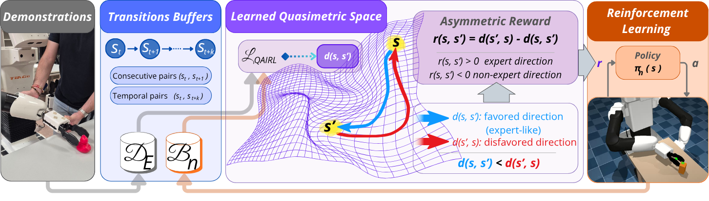
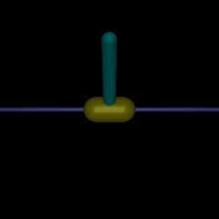
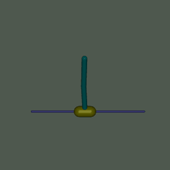
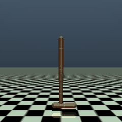
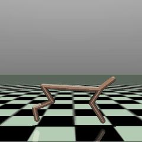
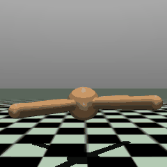
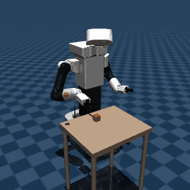
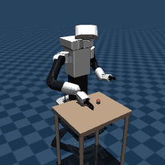

# QA-IRL: Quasimetric Asymmetry for Inverse Reinforcement Learning

Paper: preprint, link to be added.

<p align="center">
  
</p>

QA-IRL learns an asymmetric distance between states from the temporal order of expert demonstrations and
uses its asymmetry as the reward. No reward labels, goal annotations or trajectory rankings are needed.
The reward and the policy (SAC) are learned together, without a pretraining stage.

<p align="center">
  
  
  
  
  <br>
  <sub>Pendulum | InvertedPendulum | InvertedDoublePendulum | Hopper</sub>
</p>

<p align="center">
  
  
  
  
  <br>
  <sub>HalfCheetah | Ant | TIAGo++ Fetch Pick | TIAGo++ Fetch Push</sub>
</p>

Trained QA-IRL policies acting deterministically on the reward they learned from the demonstrations.
On the Gymnasium tasks each GIF shows the first 4 seconds of the evaluation episode. On the Fetch tasks it
shows a full episode with the checkpoints deployed on the physical TIAGo++ (Pick at 0.35M steps, Push at
0.85M steps). The Fetch environments are in [tiago-fetch-envs](https://github.com/FranJNaranjo/tiago-fetch-envs).

The distance is a max-ReLU quasimetric on a learned embedding phi(s) in R^{K x M}:

    d(s, s') = (1/K) sum_k max_m relu(phi(s)[k, m] - phi(s')[k, m])
    r(s, s') = clip(d(s', s) - d(s, s'), -R, R)

d is non-negative, d(s, s) = 0 and it satisfies the triangle inequality by construction. Three terms train
it. L_push pushes expert temporal pairs (s_t, s_{t+k}) apart, under a budget c0 on consecutive expert
transitions that a Lagrange multiplier enforces. L_NCE contrasts expert pairs against states the policy
visited, with a weight that decays to 0. L_dir asks for a reward of at least m on every consecutive expert
transition.

## Results

Numbers reported in the paper, where the comparison with seven baselines is also given.

Final return on the Gymnasium tasks (mean and standard deviation over 5 seeds, 10 deterministic episodes per
seed):

| Environment | QA-IRL | Expert |
|---|---|---|
| Pendulum | -127 +/- 7 | -257 |
| InvertedPendulum | 1000 +/- 0 | 1000 |
| InvertedDoublePendulum | 9342 +/- 2 | 9353 |
| Hopper | 3424 +/- 506 | 3858 |
| HalfCheetah | 9373 +/- 893 | 16243 |
| Ant | 2572 +/- 2237 | 6673 |

TIAGo++ Fetch tasks in simulation (mean and standard deviation over 3 seeds, 50 held-out episodes per seed;
the expert is the scripted demonstrator):

| Task | QA-IRL success | QA-IRL return | Expert success | Expert return |
|---|---|---|---|---|
| Pick | 81 +/- 17 % | -35 +/- 6 | 100 % | -51 |
| Push | 83 +/- 8 % | -33 +/- 6 | 96 % | -36 |

On the physical TIAGo++, the deployed policies succeeded in 8 of 10 Pick trials and 9 of 10 Push trials.

## Installation

```bash
git clone https://github.com/FranJNaranjo/qa-irl.git
cd qa-irl
pip install -e ".[data]"          # add ,fetch for the TIAGo++ Fetch tasks, ,test for pytest
```

Requires Python 3.10 or newer, PyTorch 2, Stable-Baselines3 2.3 or newer and Gymnasium 1.x with MuJoCo.
The Fetch tasks use [tiago-fetch-envs](https://github.com/FranJNaranjo/tiago-fetch-envs).

## Demonstrations

```bash
python -m qairl.data --env hopper halfcheetah     # or --all
```

Files go to `data/<env>/expert_data.npy` (change it with `--data_dir` or `QAIRL_DATA`).

| Environment | Source |
|---|---|
| `inverted_pendulum`, `inverted_double_pendulum`, `hopper`, `halfcheetah`, `ant` | every episode of the Minari dataset `mujoco/<task>/expert-v0` |
| `fetch_pick`, `fetch_push` | scripted experts of tiago-fetch-envs (200 Pick and 40 Push demos), regenerated exactly |
| `pendulum` | 40 rollouts of a PPO expert, on Hugging Face (link to be added) |

## Pretrained checkpoints

The policies shown in the GIFs are on Hugging Face (link to be added), with their `hparams.json` and, for
Push, the VecNormalize statistics. Evaluate one with `python -m qairl.evaluate --run <directory>`.

## Training and evaluation

```bash
python -m qairl.train --env hopper --seed 0
python -m qairl.evaluate --run runs/hopper/s0
```

`qairl/configs.py` holds every setting: `SHARED` for all environments and `ENVS` for what changes per
environment. Any setting can be overridden on the command line, for example `--total_timesteps 20000`.
A run writes to `runs/<env>/<run_name>/` (default run name `s<seed>`): `hparams.json`, TensorBoard logs in
`tb/`, checkpoints every 50k steps and the final models. Running the same command again resumes from the
latest checkpoint.

`qairl.evaluate` follows the protocol of the paper. On the Gymnasium tasks it runs 10 deterministic episodes
after resetting the environment once with seed 12345. On the Fetch tasks it runs 50 deterministic episodes,
episode i reset with seed 100000 + i, and reports the success rate.

### Settings

Every environment uses alpha_0 = 1, lambda_dir = 1, eps = m = tau = c0, R = 30 c0, encoder lr 3e-4, dual lr
5e-3, SAC lr 3e-4 with batch 256 and automatic entropy, and no observation normalization.

| Environment | c0 | K x M | encoder | H | alpha decay | updates | budget |
|---|---|---|---|---|---|---|---|
| `pendulum` | 0.1 | 4 x 4 | 2 x 128 | 10 | 0.5 | 40 / 500 steps | 0.5M |
| `inverted_pendulum` | 1 | 4 x 4 | 1 x 64 | 15 | 0.5 | 20 / 1000 steps | 0.3M |
| `inverted_double_pendulum` | 1 | 8 x 8 | 2 x 256 | 20 | 0.7 | 20 / 2000 steps | 1M |
| `hopper` | 1 | 8 x 8 | 2 x 256 | 20 | 0.5 | 20 / 2000 steps | 1M |
| `halfcheetah` | 1 | 8 x 8 | 2 x 256 | 30 | 0.5 | 30 / 2000 steps | 2M |
| `ant` | 1 | 8 x 8 | 2 x 256 | 30 | 0.6 | 30 / 2000 steps | 2M |
| `fetch_pick` | 0.1 | 8 x 8 | 1 x 128 | 20 | 0.5 | 20 / 100 steps | 1M |
| `fetch_push` | 0.1 | 8 x 8 | 1 x 128 | 20 | 0.5 | 20 / 100 steps | 1M |

The Fetch tasks use gamma 0.98 and an initial lambda of 10, and `fetch_push` normalizes observations with
VecNormalize.

### Ablations

| Flag | Change |
|---|---|
| `--head mlp` | pairwise MLP distance without the triangle inequality |
| `--no_push` | no L_push and no budget constraint |
| `--lambda_dir 0` | no L_dir |
| `--alpha_0 0` | no L_NCE |
| `--anneal_frac 1e6` | L_NCE with a constant weight |
| `--temporal_order shuffled` or `reversed` | states of each demonstration permuted or reversed |

## Reproducing the paper

Run from the repository root; `JOBS` sets the number of parallel runs.

```bash
python -m qairl.data --all
JOBS=4 bash experiments/benchmark.sh     # 6 tasks x 5 seeds
JOBS=4 bash experiments/ablations.sh     # Pendulum, HalfCheetah, Ant x 3 seeds
JOBS=6 bash experiments/fetch.sh         # Pick and Push x 3 seeds
bash experiments/synthetic.sh            # gridworld and reversible task, a few minutes on a CPU
```

Each script ends by evaluating its runs and writes the results to `runs/<env>/<run>/eval.json`. The
synthetic experiments write `results/synthetic/*.json`.

## Tests

```bash
pip install -e ".[test]"
pytest tests
```

## Citation

The BibTeX entry will be added with the preprint.

## License

MIT (`LICENSE`).
